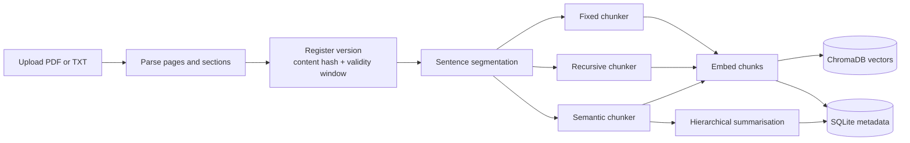
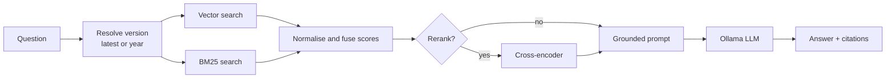

# SemantiKB

### Private, Local-First Question Answering Over Your Documents, Powered by Semantic Chunking

<div align="center">


**[Live Demo](https://robiul-hasan-jisan.github.io/SemantiKB/)** ·
[Overview](#overview) ·
[What We Built](#what-we-built) ·
[What We Learned](#what-we-learned) ·
[Quick Start](#quick-start) ·
[API Reference](#api-reference)

</div>

---


## Overview
 
SemantiKB is a retrieval-augmented generation (RAG) system that lets you upload PDF or text documents and ask questions about them. Answers are generated **only from your documents** and come with citations to the document, version and page they were drawn from.
 
Everything runs on your own machine: Sentence Transformers produce embeddings, ChromaDB stores vectors, SQLite stores structure and history, and Ollama serves the language model. There are no paid APIs and no data leaves the device.
 
The project is built around one question: **how much does the way you split a document affect the quality of retrieval?** Instead of assuming an answer, SemantiKB implements three chunking strategies side by side and ships an evaluation harness to measure them on the same documents and queries.
 
| | |
|---|---|
| **Problem** | Fixed-size chunking cuts text by a counter, not by meaning, so related facts get separated and unrelated facts get mixed. |
| **Approach** | Detect topic changes from sentence-embedding similarity and cut there, with size guards, overlap and respect for document structure. |
| **Proof** | A built-in harness compares fixed, recursive and semantic chunking on Precision@K, Recall@K, MRR, NDCG, faithfulness, size and latency. |
| **Constraint** | 100% local, CPU-friendly, no external services. |
 
---
 
## Table of contents
 
1. [The problem](#the-problem)
2. [What we built](#what-we-built)
3. [How it works](#how-it-works)
4. [Evaluation methodology](#evaluation-methodology)
5. [What we learned](#what-we-learned)
6. [Technology stack](#technology-stack)
7. [Quick start](#quick-start)
8. [Configuration](#configuration)
9. [API reference](#api-reference)
10. [Project structure](#project-structure)
11. [Testing](#testing)
12. [Limitations and roadmap](#limitations-and-roadmap)
13. [License](#license)
---
 
## The problem
 
RAG systems retrieve passages ("chunks") and hand them to a language model. The model can only be as good as what it is given, and the chunking step decides what a passage is.
 
- **Fixed-size chunking** splits every *N* tokens. A policy rule and its exception can land in different chunks. A query about the exception retrieves only the rule, and the model confidently states the general rule without the exception.
- **Recursive chunking** (for example LangChain's `RecursiveCharacterTextSplitter`) prefers paragraph and sentence breaks, which helps, but it has no notion of meaning. Two paragraphs on unrelated subjects are merged if they fit the budget, while one coherent argument slightly over budget is still cut.
- **Blurry embeddings.** A chunk that mixes two topics has an embedding that is an average of both, so it ranks poorly for queries about either.
The root cause is that the chunk boundary is a property of the *counter*, not of the *content*.
 
---
 
## What we built
 
| Capability | Description |
|---|---|
| **Semantic chunking** | Embeds each sentence, measures similarity between neighbours, and cuts where similarity drops. Enforces minimum and maximum chunk size, can prefer paragraph and heading boundaries, and carries sentence overlap across boundaries. |
| **Three strategies, one pipeline** | Fixed, recursive and semantic chunkers are all run at ingestion and stored, so they can be compared on identical source material. |
| **Hybrid retrieval** | Vector search (ChromaDB) combined with BM25 keyword search through normalised score fusion. Modes: `vector`, `bm25`, `hybrid`. |
| **Optional reranking** | A cross-encoder (`ms-marco-MiniLM-L-6-v2`) can rerank the top candidates. |
| **Grounded answers** | A strict system prompt restricts the model to the retrieved context, requires inline source tags, and mandates an explicit "not enough information" reply when the answer is absent. Structured citations are returned with every response. |
| **Hierarchical summaries** | Chunk, section and document summaries are produced bottom-up, with an extractive fallback if the LLM is unavailable so ingestion never fails. |
| **Document versioning** | Re-uploading creates a new version with a content hash and a validity window. Versions can be diffed, and queries can be scoped to the latest version or to a year. |
| **Temporal retrieval** | Phrases such as "latest" or a year in the query are resolved to a concrete document version before retrieval. |
| **Evaluation harness** | Runs every strategy through the same retrieval against labelled queries and reports ranking metrics, answer quality, storage and latency. Results are persisted. |
| **Web interface** | Dependency-free vanilla JS front end with chat, summary and chunk inspection, version history and evaluation tabs. |
| **Engineering basics** | Typed FastAPI + Pydantic API, unit tests, GitHub Actions CI, Docker Compose, environment-driven configuration. |
 
---
 
## How it works
 
### Ingestion
 

 
SQLite is the source of truth for relational data (documents, versions, pages, sections, chunks, summaries). ChromaDB holds vectors plus a copy of the filter fields. Data flows **document, version, section, chunk, sentence** at every layer.
 
### Query time
 

 
### Semantic chunking algorithm
 
The implementation is in [`backend/chunking/semantic_chunker.py`](backend/chunking/semantic_chunker.py).
 
1. Embed every sentence with `all-MiniLM-L6-v2` (normalised vectors).
2. Compute cosine similarity between each pair of consecutive sentences. The signal stays high inside a topic and drops where the topic changes.
3. Mark a candidate boundary where similarity falls below `CHUNK_SIMILARITY_THRESHOLD`.
4. Honour the boundary only if the chunk so far has reached `CHUNK_MIN_SIZE_TOKENS`. This prevents fragments on choppy text such as lists and dialogue.
5. Force a split if a chunk would exceed `CHUNK_MAX_SIZE_TOKENS`, so every chunk fits the embedding model and the LLM context.
6. When `PREFER_PARAGRAPH_BOUNDARIES` is on, prefer a nearby paragraph or heading edge from the source over a purely embedding-derived cut, because authors' own structure is a strong free signal.
7. Carry `CHUNK_OVERLAP_TOKENS` of trailing sentences into the next chunk so context is not lost at the seam.
The threshold controls granularity:
 
| Threshold | Effect | Suited to |
|---|---|---|
| Lower (about 0.4) | Splits only on strong topic shifts, so fewer and larger chunks | Narrative or loosely structured text |
| Higher (about 0.8) | Splits on subtler shifts, so more and smaller chunks | Policies, specifications, reference material |
 
### Hybrid retrieval
 
Vector scores and BM25 scores live on different scales, so each is **min-max normalised** and then blended:
 
```
final = alpha * vector_score + (1 - alpha) * bm25_score        (HYBRID_ALPHA, default 0.5)
```
 
Dense retrieval captures paraphrase and meaning; BM25 captures exact terms such as names, codes and numbers. Candidates are over-fetched (3x `TOP_K`) from both sides before fusion.
 
### Grounded generation
 
The prompt in [`backend/llm/rag_pipeline.py`](backend/llm/rag_pipeline.py) instructs the model to answer only from the supplied context, avoid inventing names, numbers or dates, cite sources as `[Source n]`, respect version and time scope, and reply with an explicit "I don't have enough information" message when the context does not contain the answer. If retrieval returns nothing, the model is not called at all.
 
### Versioning and temporal retrieval
 
Each upload receives an incrementing version number, a SHA-based content hash and a `valid_from` / `valid_to` window. `POST /api/documents/diff` compares two versions line by line (added, removed and changed blocks plus an overall similarity ratio). When a query mentions "latest" or a year, a `TemporalResolver` maps it to the matching version before search, so answers reflect the right revision of a policy or specification.
 
---
 
## Evaluation methodology
 
Comparing chunkers is tricky because each produces different chunk IDs. SemantiKB avoids that by defining relevance **at the page level** and mapping it onto each strategy's own chunks, so every strategy is judged against the same ground truth.
 
**Input** (one labelled query):
 
```json
{
  "query": "What is the refund policy?",
  "document_id": "doc_abc123",
  "relevant_pages": [2, 3],
  "reference_answer": "Refunds are available within 30 days of purchase."
}
```
 
**Metrics reported per strategy**
 
| Metric | Measures |
|---|---|
| Precision@K | Share of the top K results that are relevant |
| Recall@K | Share of all relevant chunks found in the top K |
| MRR | How early the first relevant chunk appears |
| NDCG@K | Ranking quality, rewarding relevant results near the top |
| Answer relevance, faithfulness | LLM-judged quality of the generated answer (needs a `reference_answer`) |
| Chunk count, storage bytes | Index size and cost |
| Average retrieval latency | Speed |
 
Run it with `POST /api/evaluate?k=5`, review past runs with `GET /api/evaluate/history`, or use the **Evaluation** tab in the UI.
 
<!-- Paste your benchmark table here after running the evaluation on your own documents. -->
 
---
 
## What we learned
 
These are the main engineering lessons from designing and building the system.
 
**1. Chunk boundaries should come from content, not counters.**
Splitting on meaning keeps an idea and its qualifications together, so each chunk's embedding represents one coherent topic. Mixing two topics in one chunk, or cutting one topic in two, both degrade retrieval.
 
**2. Guard rails matter as much as the signal.**
A raw similarity threshold alone produces tiny fragments on noisy text and oversized blocks on uniform text. Minimum and maximum sizes, overlap and a preference for existing document structure are what make semantic chunking usable in practice.
 
**3. The right threshold depends on the corpus, so make it measurable.**
There is no universal value. A narrative document and a legal policy want different granularity. Exposing the threshold as configuration and shipping an evaluation harness turns tuning into an experiment rather than a guess.
 
**4. Compare strategies on equal footing.**
Different chunkers yield different chunk IDs, so naive comparison is invalid. Defining relevance at page level and mapping it to each strategy's chunks makes the comparison fair, and ingesting all three strategies from the same sentences removes data differences.
 
**5. Dense and lexical retrieval fail in different ways.**
Embeddings handle paraphrase but can miss exact identifiers; BM25 does the opposite. Their raw scores are not comparable, so normalising before fusing is essential. Exposing `alpha` makes the balance tunable.
 
**6. Grounding is a system property, not just a prompt.**
Strict instructions help, but reliability also comes from structure: returning citations as data, skipping the LLM entirely when retrieval finds nothing, and scoping context by version so the model cannot mix revisions.
 
**7. Documents change, so time is part of retrieval.**
Treating versions and validity windows as first-class data allows questions such as "what did the policy say in 2023?" and makes "latest" unambiguous.
 
**8. Design for graceful degradation in local-first systems.**
Local components fail more often than hosted ones. Sentence segmentation falls back to a regex splitter if NLTK data is missing, and summarisation falls back to extractive summaries if Ollama is unreachable, so ingestion always completes.
 
**9. Test the logic without the model.**
The chunker tests use a deterministic fake embedder with orthogonal topic vectors, which verifies boundary detection, size limits and overlap quickly and without downloading a model.
 
**10. Separate concerns in storage.**
Using SQLite for relational truth (versions, hierarchy, evaluation runs) and ChromaDB only for vectors keeps each store doing what it is best at and makes history and diffing straightforward.
 
---
 
## Technology stack
 
| Layer | Choice | Why |
|---|---|---|
| API | FastAPI, Pydantic v2, Uvicorn | Typed request and response models, automatic OpenAPI docs |
| Embeddings | Sentence Transformers (`all-MiniLM-L6-v2`) | Small, fast on CPU, good general quality |
| Vector store | ChromaDB | Embedded, file-based, no server to run |
| Keyword search | `rank-bm25` | Simple, effective lexical baseline |
| Reranking | Cross-encoder (`ms-marco-MiniLM-L-6-v2`) | Optional precision boost on top candidates |
| LLM | Ollama (default `llama3.1`) | Local inference, swappable models |
| Metadata | SQLite | Zero-config relational store for versions and hierarchy |
| Parsing | `pypdf`, NLTK, `tiktoken` | PDF text, sentence splitting, accurate token counts |
| Front end | Vanilla JS (ES modules) | No build step or dependencies |
| Quality | pytest, GitHub Actions, Docker Compose | Repeatable tests and deployment |
 
---
 
## Quick start
 
**Prerequisites:** Python 3.10+, and [Ollama](https://ollama.com) with a model pulled:
 
```bash
ollama pull llama3.1
```
 
**Backend**
 
```bash
git clone https://github.com/YOUR_USERNAME/SemantiKB.git
cd SemantiKB
python -m venv .venv && source .venv/bin/activate     # Windows: .venv\Scripts\activate
pip install -r requirements.txt
cp .env.example .env
python -c "import nltk; nltk.download('punkt_tab')"   # optional, regex fallback if skipped
uvicorn backend.main:app --reload --port 8000
```
 
**Front end** (second terminal)
 
```bash
cd frontend
python -m http.server 5173
```
 
Open <http://localhost:5173>. Interactive API docs are at <http://localhost:8000/docs>. If the backend is not on `localhost:8000`, edit `window.PKA_API_BASE_URL` in `frontend/index.html`. The first run downloads the embedding model (about 90 MB); afterwards everything works offline.
 
**Docker**
 
```bash
docker compose up --build
docker compose exec ollama ollama pull llama3.1
```
 
---
 
## Configuration
 
All settings are environment variables. Copy `.env.example` to `.env` and adjust.
 
| Variable | Default | Purpose |
|---|---|---|
| `EMBEDDING_MODEL` | `sentence-transformers/all-MiniLM-L6-v2` | Sentence embedding model |
| `EMBEDDING_DEVICE` | `cpu` | Set to `cuda` for GPU |
| `CHUNK_SIMILARITY_THRESHOLD` | `0.65` | Similarity below which a topic boundary is proposed |
| `CHUNK_MIN_SIZE_TOKENS` | `80` | Smallest allowed semantic chunk |
| `CHUNK_MAX_SIZE_TOKENS` | `400` | Largest allowed semantic chunk |
| `CHUNK_OVERLAP_TOKENS` | `30` | Sentence overlap carried across boundaries |
| `PREFER_PARAGRAPH_BOUNDARIES` | `true` | Favour structural breaks near semantic cuts |
| `FIXED_CHUNK_SIZE_TOKENS` / `RECURSIVE_CHUNK_SIZE_TOKENS` | `250` | Baseline chunk sizes |
| `RETRIEVAL_MODE` | `hybrid` | `vector`, `bm25` or `hybrid` |
| `HYBRID_ALPHA` | `0.5` | Weight of vector score in hybrid fusion |
| `TOP_K` | `5` | Results returned |
| `USE_RERANKER` | `false` | Enable cross-encoder reranking |
| `RERANK_TOP_N` | `20` | Candidates passed to the reranker |
| `ENABLE_HIERARCHICAL_SUMMARIZATION` | `true` | Build chunk, section and document summaries |
| `OLLAMA_BASE_URL` / `OLLAMA_MODEL` | `http://localhost:11434` / `llama3.1` | LLM endpoint and model |
| `OLLAMA_TEMPERATURE` | `0.1` | Low temperature for factual answers |
| `CORS_ORIGINS` | `http://localhost:5173,http://localhost:3000` | Allowed front-end origins |
 
---
 
## API reference
 
| Method | Endpoint | Description |
|---|---|---|
| `GET` | `/api/health` | Service status and Ollama reachability |
| `POST` | `/api/documents/upload` | Upload a `.pdf` or `.txt`; pass `existing_document_id` to create a new version |
| `GET` | `/api/documents` | List documents |
| `GET` | `/api/documents/{id}/versions` | List versions of a document |
| `GET` | `/api/documents/{id}/summary` | Hierarchical summary (optional `version`) |
| `GET` | `/api/documents/{id}/chunks` | Inspect chunks (`strategy`, optional `version`) |
| `POST` | `/api/documents/diff` | Diff two versions |
| `POST` | `/api/chat` | Retrieve, optionally rerank, and generate a cited answer |
| `POST` | `/api/retrieve` | Retrieval only, no generation |
| `GET` | `/api/config/chunking` | Current chunking settings |
| `POST` | `/api/evaluate` | Compare chunking strategies on labelled queries |
| `GET` | `/api/evaluate/history` | Stored evaluation runs |
 
**Example**
 
```bash
curl -X POST http://localhost:8000/api/chat \
  -H "Content-Type: application/json" \
  -d '{"query": "What is the refund policy?", "strategy": "semantic", "top_k": 5}'
```
 
The response contains `answer`, `citations` (document, version, page, chunk ID) and the `retrieved_chunks` with their vector, BM25 and hybrid scores.
 
---
 
## Project structure
 
```
SemantiKB/
  backend/
    ingestion/       PDF/TXT parsing, sentence segmentation, pipeline orchestration
    chunking/        Fixed, recursive and semantic chunkers, plus factory
    embeddings/      Sentence Transformer wrapper
    retrieval/       BM25, hybrid fusion, temporal resolution
    reranking/       Optional cross-encoder reranker
    summarization/   Hierarchical chunk, section and document summaries
    versioning/      Version registration, diffing
    llm/             Ollama client, grounded RAG prompt and citations
    evaluation/      IR metrics and strategy comparison harness
    database/        SQLite schema and repository, ChromaDB wrapper
    tests/           Unit tests
    config.py        Environment-driven settings
    models.py        Shared Pydantic schema
    main.py          FastAPI application
  frontend/          Chat, insights, version history and evaluation UI
  demo/              Static interactive demo (deployed to GitHub Pages)
  data/              Runtime storage (git-ignored)
  Dockerfile, docker-compose.yml, .github/workflows/
```
 
---
 
## Testing
 
```bash
pytest backend/tests -v
```
 
The suite covers chunking behaviour (size budgets, boundary detection with a deterministic fake embedder), ingestion, ranking metrics and versioning. It runs in CI on every push.
 
---
 
## Limitations and roadmap
 
**Known limitations**
 
- PDF section and heading detection is heuristic (regex based), not full layout analysis. Multi-column or image-heavy PDFs work less well, and scanned PDFs need OCR first.
- Recursive-chunker page and section metadata is best-effort text matching.
- The BM25 index is rebuilt in memory per query, which is fine for small and medium collections but not for very large ones.
- Semantic chunking adds ingestion cost, since every sentence must be embedded.
- There is no authentication; the service is intended for local or trusted-network use.
**Roadmap**
 
- Persistent BM25 inverted index
- Layout-aware PDF parsing and OCR
- Additional formats (DOCX, HTML, Markdown)
- Authentication and multi-user workspaces
- Streaming answers in the UI
- Automatic threshold tuning from the evaluation harness
---
 

 
<div align="center">
Built by **YOUR NAME** &nbsp;|&nbsp; [GitHub](https://github.com/YOUR_USERNAME) &nbsp;|&nbsp; [LinkedIn](https://linkedin.com/in/YOUR_PROFILE)
 
</div>
 
