<div align="center">

# 🧩 SemantiKB

**A private, local-first RAG system with semantic chunking and a built-in evaluation harness.**

[](https://github.com/YOUR_USERNAME/SemantiKB/actions)


[**Live interactive demo**](https://YOUR_USERNAME.github.io/SemantiKB/) · [Architecture](#architecture) · [Quick start](#quick-start) · [Evaluation](#evaluation)

</div>

SemantiKB lets you upload documents and ask questions about them, with grounded answers and citations. Everything runs on your machine: Sentence Transformers for embeddings, ChromaDB for vectors, Ollama for the LLM. **No paid APIs, no data leaves your device.**

Its core idea is **semantic chunking**: instead of cutting a document every *N* tokens, it embeds each sentence and splits where the *topic* actually changes. The repo ships an evaluation harness that benchmarks fixed, recursive and semantic chunking on identical queries, so the benefit can be measured on your own documents rather than assumed.

## Features

| Area | What it does |
|---|---|
| **Semantic chunking** | Boundary detection from consecutive-sentence cosine similarity, with min/max size guards, paragraph-boundary preference and sentence overlap |
| **Hybrid retrieval** | Vector search + BM25 fused with a tunable weight; optional cross-encoder reranking |
| **Grounded answers** | Local LLM via Ollama, answers cite source chunks and pages |
| **Hierarchical summaries** | Chunk → section → document summaries |
| **Document versioning** | Re-upload to create versions; temporal lookup and version diffing |
| **Evaluation harness** | Precision@K, Recall@K, MRR, NDCG, answer relevance, faithfulness, chunk count, storage and latency across strategies |
| **Typed, tested API** | FastAPI + Pydantic models, pytest suite, CI, Docker |

## Architecture

```mermaid
flowchart LR
    A[Upload] --> B[Parse]
    B --> C[Sentence segmentation]
    C --> D[Sentence embeddings]
    D --> E[Semantic boundary detection]
    E --> F[Context-aware chunking]
    F --> G[Hierarchical summarization]
    G --> H[(ChromaDB + SQLite)]
    H --> I[Hybrid retrieval + optional rerank]
    I --> J[Ollama LLM]
    J --> K[Grounded answer + citations]
```



```
backend/
  ingestion/      PDF/TXT parsing, sentence segmentation, pipeline
  chunking/       Fixed / recursive / semantic chunkers + factory
  embeddings/     Sentence Transformer wrapper
  retrieval/      BM25 and hybrid vector+keyword retrieval
  reranking/      Optional cross-encoder reranker
  summarization/  Hierarchical summaries
  versioning/     Version registration, temporal lookup, diffing
  llm/            Ollama client and grounded RAG prompting
  evaluation/     IR metrics and strategy-comparison harness
  database/       SQLite repository, ChromaDB wrapper
  tests/          Unit tests
frontend/         Dependency-free vanilla JS UI (ES modules, no build step)
```

## How semantic chunking works

1. Embed every sentence (`all-MiniLM-L6-v2` by default).
2. Compute cosine similarity between each pair of consecutive sentences. It stays high within a topic and drops at a topic shift.
3. Mark a candidate boundary wherever similarity falls below `CHUNK_SIMILARITY_THRESHOLD`.
4. Honour a boundary only if the chunk has reached `CHUNK_MIN_SIZE_TOKENS`; force a split at `CHUNK_MAX_SIZE_TOKENS`.
5. Prefer nearby paragraph/heading boundaries when present, and carry `CHUNK_OVERLAP_TOKENS` into the next chunk.

| Threshold | Effect | Suited to |
|---|---|---|
| Lower (≈ 0.4) | Fewer, larger chunks | Narrative or loosely structured text |
| Higher (≈ 0.8) | More, smaller, tightly focused chunks | Policies, specs, reference docs |

The [live demo](https://YOUR_USERNAME.github.io/SemantiKB/) visualises this in the browser (it uses TF-IDF similarity so it needs no backend; the full app uses neural embeddings).

## Deploying the demo

The interactive demo in [`demo/`](demo) is a single static file. It deploys automatically to GitHub Pages on every push to `main` (enable **Settings → Pages → Source: GitHub Actions**), or to Vercel/Netlify by importing the repo (`vercel.json` is included).

## Quick start

**Prerequisites:** Python 3.10+, [Ollama](https://ollama.com) with a model pulled (`ollama pull llama3.1`).

```bash
git clone https://github.com/YOUR_USERNAME/SemantiKB.git && cd SemantiKB
python -m venv .venv && source .venv/bin/activate
pip install -r requirements.txt
cp .env.example .env
python -c "import nltk; nltk.download('punkt_tab')"   # optional; regex fallback if skipped
uvicorn backend.main:app --reload --port 8000
```

In a second terminal, serve the UI and open <http://localhost:5173>:

```bash
cd frontend && python -m http.server 5173
```

The first run downloads the embedding model (~90 MB); after that everything works offline. Interactive API docs are at <http://localhost:8000/docs>.

**With Docker:** `docker compose up --build`, then `docker compose exec ollama ollama pull llama3.1`.

**Tests:** `pytest backend/tests -v`

## Evaluation

`POST /api/evaluate` takes labelled queries and runs all three chunking strategies through identical retrieval:

```json
[{
  "query": "What is the refund policy?",
  "document_id": "doc_abc123",
  "relevant_pages": [2, 3],
  "reference_answer": "Refunds are available within 30 days of purchase."
}]
```

It returns Precision@K, Recall@K, MRR and NDCG (plus LLM-judged relevance and faithfulness when a reference answer is given). Runs are stored in SQLite (`GET /api/evaluate/history`) and available in the UI's **Evaluation** tab.

## Configuration

All settings are environment variables; see [`.env.example`](.env.example) for the full list: chunking threshold and sizes, retrieval mode (`vector` / `bm25` / `hybrid`), hybrid weighting, reranker toggle, Ollama model and host, summarization toggle.

## Privacy and cost

| Component | Runs | Notes |
|---|---|---|
| Embeddings | Local | Sentence Transformers, no API key |
| Vector DB | Local | ChromaDB, file-based under `./data/chroma` |
| LLM | Local | Ollama, nothing leaves your machine |

## Known limitations

- PDF heading detection is heuristic (regex), not full layout analysis; multi-column or image-heavy PDFs work less well.
- Recursive-chunker page/section metadata is best-effort text matching.
- The BM25 index is rebuilt in memory per query; a persistent inverted index would suit large corpora.

## Roadmap

- Persistent BM25 index
- Layout-aware PDF parsing
- Authentication and multi-user workspaces

## License

[MIT](LICENSE)
